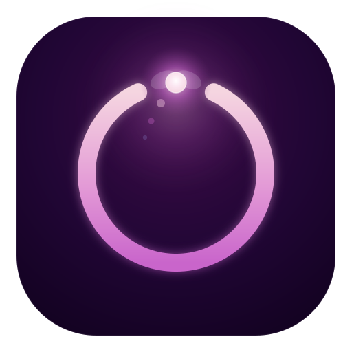

  

# Firefly Focus

> A calm, private focus timer for Windows. A small icon and a compact timer stay over your other programs, a pixel-art cat keeps you company, and one click opens a clean fullscreen timer. Everything stays on your computer: no account, no tracking, no network.

---

## ✨ Features

- **Stays over your other programs** — a small icon shows how far the timer has got, and a compact timer with your tasks floats beside your work. Clicks pass through to the program underneath everywhere except on them.
- **A cat for company** — it strolls across your screen, peeks in from behind its edges, chases a bouncing ball all over it, hunts a firefly and your mouse pointer, and purrs when you pet it. Pick it, or the ball, up and toss it wherever you like. It behaves during a focus session and is delighted when one ends. One button shows all it can do.
- **Mischief, if you want it** — switch it on in the settings and the cat hides behind your desktop icons, jumps on them and bites one now and then. A bitten icon will not open with the mouse until you click the cat, pull it away or turn on the ball. A second setting lets it drag icons to new places too, never touching the files, and they go back when you switch that off or close the program. Both are off by default.
- **Fullscreen timer** — one click on the time opens a clean, whole-screen timer with drifting fireflies. The controls fade away while you work and return on the first mouse move.
- **Easy to set** — ready-made rhythms (25/5, 50/10, 52/17, 90/20, 15/3) or your own, with − and + right on the widget.
- **Pomodoro-style cycles** — focus, short break and long break, with auto-continue if you want it.
- **Tasks with deadlines** — overdue tasks turn red, tasks due soon turn amber, and they stay until you are done with them.
- **Runs in the background** — put the icon and widgets away, and the timer keeps going with its progress on the taskbar button.
- **Your choice of look** — the Midnight, Daylight and Sage themes, three timer faces, and fireflies if you want them.
- **Warm sound signals** — four non-harsh sound styles for stage changes and reminders, plus Windows notifications.
- **Daily stats and goal** — sessions completed today, focus time and progress toward your goal.
- **7 languages** — English, Ukrainian, German, Spanish, Italian, Slovak and Czech. It starts in your system's language.
- **Private by design** — no sign-in, no analytics, and it does not go online at all.

---

## 📦 Install

> _Microsoft Store link coming soon._

To run it from source, see [desktop/README.md](desktop/README.md).

---

## 🚀 Usage

- **The icon** — click it to open or close the widgets, drag it anywhere, right-click it for the menu.
- **The widget** — press Start or Pause, and click the time for the fullscreen timer. With the pointer on it, small buttons appear on its top edge: fireflies, the timer's rhythm, and hide. Drag it by any free spot.
- **The cat** — 🐾 lets it wander the screen, where you can drag it to pick it up and let go to drop or throw it. ⚽ gives it a ball to chase around the screen, which you can pick up and throw too, and the wave makes it purr. A tap on the cat purrs too. The last button shows everything it can do, on folders of its own.
- **The main window** — holds your tasks, statistics and settings. Its X only minimizes it, because the timer keeps running.
- **Quitting** — use **Close the program and stop the timer** in the menu or at the bottom of the settings.

The widgets and the cat appear on your main display.

---

## 🔒 Privacy

Your timer state, tasks, settings and statistics stay on your computer. Nothing is sent anywhere: there are no accounts, no analytics and no network requests. See [PRIVACY.md](PRIVACY.md) for the full policy.

---

## 🧩 Project structure

| File | Role |
|---|---|
| `desktop/` | The program itself: windows, data, tray, on-screen icon, the helper for the desktop icons, packaging. See [desktop/README.md](desktop/README.md). |
| `service_worker.js` | The timer: state, alarms, cycles, stats, tasks, settings. |
| `sidepanel.html` / `.css` / `.js` | The main window's page. |
| `fullscreen.html` / `.css` / `.js` | The fullscreen timer. |
| `floating_widget.js` | The timer and task widget. |
| `buddy.js` | The cat: drawing, animation and purr. |
| `offscreen.js` | Sound synthesis for the signals. |
| `shared.js` | Translations and what the pages share. |
| `manifest.json`, `index.html`, `ambient.html`, `sw.js`, `app/` | A browser version made from the same files. It is not part of the program; its notes are in `docs/browser-version/`. |

---

## 🛠️ Tech

- **Electron**, with plain HTML, CSS and JavaScript and no frameworks.
- **Web Audio API** synthesises all sounds, including the purr. No audio files are shipped.
- **The cat is drawn from shapes** when the program starts. There are no image files for it.
- Packaged for the Microsoft Store with electron-builder.

---

## 📄 License

Released under the [MIT License](LICENSE).
